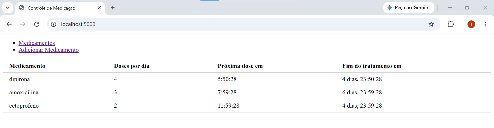

# 💊 Controle de Medicação



Aplicação web para cadastrar medicamentos de um tratamento e acompanhar, em uma tabela, **quanto tempo falta para a próxima dose** e **quanto tempo falta para o fim do tratamento**. O app também avisa na hora de tomar cada dose, com **notificação do navegador**, e permite **confirmar** a dose tomada com um botão.

Projeto feito em Python com Flask e SQLite, como parte dos meus estudos de desenvolvimento de software. Tem foco em aprender conceitos de back-end e de integração com o front-end: rotas, formulários, persistência em banco de dados, templates, cálculo com datas e JavaScript.

---

## 📋 Sumário

- [Funcionalidades](#-funcionalidades)
- [Tecnologias](#-tecnologias)
- [Como funciona o cálculo das doses](#-como-funciona-o-cálculo-das-doses)
- [Como funciona o alarme](#-como-funciona-o-alarme)
- [Estrutura do projeto](#-estrutura-do-projeto)
- [Como executar](#-como-executar)
- [Banco de dados](#-banco-de-dados)
- [Rotas](#-rotas)
- [Limitações conhecidas](#%EF%B8%8F-limitações-conhecidas)
- [Próximos passos](#-próximos-passos)
- [Autor](#-autor)

---

## ✅ Funcionalidades

- **Cadastro** de medicamento com nome, doses por dia (posologia) e duração do tratamento em dias.
- Registro automático da **data e hora de início** do tratamento no momento do cadastro.
- **Listagem** de todos os medicamentos em uma tabela com:
  - nome do medicamento e doses por dia;
  - tempo restante até a próxima dose;
  - tempo restante até o fim do tratamento;
  - **estado** da dose atual;
  - botões de ação: editar, excluir e marcar como tomada.
- **Estado de cada dose**, calculado a cada carregamento da página:
  - `Aguardando`: ainda não chegou a hora da próxima dose;
  - `Hora_de_tomar`: do horário da dose até 10 minutos depois;
  - `Atrasado`: passaram mais de 10 minutos e a dose não foi confirmada;
  - `Confirmado`: a dose atual já foi marcada como tomada;
  - `Finalizado`: o tratamento terminou.
- **Confirmação de dose** pelo botão "Marcar como tomada", que aparece só nos estados `Hora_de_tomar` e `Atrasado`. Confirmar a mesma dose duas vezes não cria registro duplicado.
- **Atualização automática** da página inicial a cada 60 segundos.
- **Alertas no navegador**: um botão "Ativar alertas" pede permissão ao usuário, e as notificações do sistema avisam quando uma dose está em `Hora_de_tomar` ou `Atrasado`. O som é o padrão do sistema operacional.
- **Edição** de um medicamento, com o formulário já preenchido. A data de início é preservada.
- **Exclusão** de um medicamento por requisição `POST`, evitando que um simples acesso a um link apague dados.
- Erro 404 ao tentar editar ou confirmar um medicamento que não existe.
- Durações exibidas em português, sem microssegundos (por exemplo, `3 dias, 19:15:12`).
- Validação básica no formulário: campos obrigatórios e valores numéricos mínimos.

## 🛠 Tecnologias

| Tecnologia | Uso |
|---|---|
| Python 3 | Linguagem principal |
| Flask | Servidor web, rotas e templates |
| Jinja2 | Templates HTML com herança, laços e condicionais (já incluso no Flask) |
| SQLite (`sqlite3`) | Banco de dados local, já incluso no Python |
| JavaScript | Leitura do estado das doses e notificações (Notification API) |
| HTML e CSS | Interface, com CSS e JavaScript em arquivos estáticos |

## 🧮 Como funciona o cálculo das doses

O banco guarda a data de início do tratamento, e todos os tempos são calculados a partir dela:

- **Intervalo entre doses** = `24 horas ÷ doses por dia`. Com 3 doses por dia, o intervalo é de 8 horas.
- **Primeira dose** = início do tratamento + um intervalo.
- **Próxima dose** = primeira dose cujo horário ainda não passou, somando o intervalo dose a dose.
- **Última dose passada** = última dose cujo horário já passou, dentro do período do tratamento.
- **Fim do tratamento** = início + duração em dias.
- Se a próxima dose cairia depois do fim do tratamento, não há mais doses e a tabela mostra **Horário não definido**.
- Se o fim já passou, a tabela mostra **tratamento finalizado**.

## 🔔 Como funciona o alarme

Em vez de manter um processo em segundo plano, o app **recalcula o estado de cada medicamento a cada carregamento da página**, e a página se recarrega sozinha a cada 60 segundos:

1. Para cada medicamento, a função `estado_dose` pega a última dose cujo horário já passou.
2. Ela consulta a tabela `doses_tomadas` para saber se essa dose já foi confirmada.
3. Se não foi, compara o tempo passado com a tolerância de 10 minutos: dentro dela o estado é `Hora_de_tomar`, depois dela é `Atrasado`.
4. A tabela guarda o estado e o nome de cada linha em atributos `data-`, e o `static/alertas.js` os lê e dispara uma notificação para cada dose pendente.
5. Ao clicar em "Marcar como tomada", a rota `POST /tomei/<id>` recalcula no servidor qual é a dose pendente e a grava como confirmada. O servidor faz esse cálculo para não depender de um horário enviado pelo navegador.

Como a página se recarrega a cada minuto, a notificação **se repete a cada minuto** enquanto a dose estiver pendente.

## 📁 Estrutura do projeto

```
controle-de-medicacao/
├── app.py              # Aplicação Flask: rotas
├── database.py         # Acesso ao banco SQLite (tabelas e consultas)
├── funcoes.py          # Regras de negócio: cálculo de doses, estados e formatação
├── static/
│   ├── styles.css      # Estilos da interface
│   └── alertas.js      # Permissão e notificações do navegador
├── templates/
│   ├── base.html       # Layout comum (menu, CSS e bloco de cabeçalho)
│   ├── index.html      # Lista de medicamentos, estados e botões
│   ├── add.html        # Formulário de cadastro
│   └── editar.html     # Formulário de edição
├── docs/
│   └── tabela.png      # Captura de tela usada neste README
├── requirements.txt    # Dependências do projeto
├── .gitignore
└── README.md
```

O arquivo `tratamento.db` é criado automaticamente na primeira execução e não é versionado.

## 🚀 Como executar

### Pré-requisitos

- [Python 3.10 ou superior](https://www.python.org/downloads/)
- [Git](https://git-scm.com/)
- Um navegador moderno (Chrome, Edge ou Firefox) para as notificações

### Windows (PowerShell)

```powershell
# 1. Clonar o repositório
git clone https://github.com/machadoleo00-commits/controle-de-medicacao.git
cd controle-de-medicacao

# 2. (Opcional, recomendado) Criar e ativar um ambiente virtual
python -m venv .venv
.venv\Scripts\Activate.ps1

# 3. Instalar as dependências
pip install -r requirements.txt

# 4. Rodar a aplicação
python app.py
```

> Se o PowerShell bloquear a ativação do ambiente virtual, rode `Set-ExecutionPolicy -Scope CurrentUser RemoteSigned` e tente de novo. Esse passo é opcional: o app também roda sem ambiente virtual.

### Linux ou macOS

```bash
git clone https://github.com/machadoleo00-commits/controle-de-medicacao.git
cd controle-de-medicacao
python3 -m venv .venv
source .venv/bin/activate
pip install -r requirements.txt
python app.py
```

### Acessar

Com o servidor rodando, abra no navegador: **http://127.0.0.1:5000**

Para parar o servidor, use `Ctrl + C` no terminal.

> O app roda com `debug=True`, que recarrega o servidor ao salvar arquivos. Esse modo é apenas para desenvolvimento e não deve ser usado em produção.

### Ativar os alertas

1. Na página inicial, clique em **Ativar alertas** e escolha **Permitir** quando o navegador perguntar.
2. Mantenha a página aberta: os alertas só funcionam enquanto ela está aberta no navegador.
3. No Windows, confira se o modo **Não perturbar** (ou Assistente de foco) está desligado e se as notificações do navegador estão ativadas em **Configurações → Sistema → Notificações**, senão o sistema esconde os avisos.

## 🗄 Banco de dados

SQLite, arquivo `tratamento.db`, com duas tabelas.

**`tratamento`**: os medicamentos cadastrados.

| Coluna | Tipo | Descrição |
|---|---|---|
| `id` | INTEGER (chave primária) | Identificador do registro |
| `medicamento` | TEXT | Nome do medicamento |
| `posologia` | INTEGER | Número de doses por dia |
| `tempo` | INTEGER | Duração do tratamento, em dias |
| `inicio` | TEXT | Data e hora de início (`AAAA-MM-DD HH:MM`) |

**`doses_tomadas`**: as doses confirmadas pelo botão.

| Coluna | Tipo | Descrição |
|---|---|---|
| `id` | INTEGER (chave primária) | Identificador do registro |
| `medicamento_id` | INTEGER | `id` do medicamento na tabela `tratamento` |
| `horario_previsto` | TEXT | Horário em que a dose deveria ser tomada (`AAAA-MM-DD HH:MM`) |
| `confirmado_em` | TEXT | Momento em que o botão foi apertado (`AAAA-MM-DD HH:MM`) |

As tabelas são criadas automaticamente quando o `database.py` é importado.

## 🌐 Rotas

| Método | Rota | Descrição |
|---|---|---|
| GET | `/` | Lista os medicamentos com tempos, estado e ações |
| GET | `/add` | Exibe o formulário de cadastro |
| POST | `/add` | Recebe o formulário, grava no banco e redireciona para `/` |
| GET | `/editar/<id>` | Exibe o formulário de edição preenchido (404 se o `id` não existir) |
| POST | `/editar/<id>` | Atualiza o medicamento e redireciona para `/` |
| POST | `/excluir/<id>` | Exclui o medicamento e redireciona para `/` |
| POST | `/tomei/<id>` | Confirma a dose pendente do medicamento (404 se o `id` não existir) |

## ⚠️ Limitações conhecidas

- **Só a última dose passada é verificada.** Se uma dose for esquecida e a seguinte chegar, a esquecida deixa de aparecer como pendente.
- **Os alertas dependem da página aberta** no navegador. Com a página fechada, não há notificação.
- A notificação **se repete a cada minuto** enquanto a dose estiver pendente, porque a página se recarrega nesse intervalo.
- O som é o padrão do sistema operacional, e não um som do app.
- Ao excluir um medicamento, as confirmações dele continuam na tabela `doses_tomadas`.
- Os cálculos buscam o medicamento pelo **nome**. Dois medicamentos com o mesmo nome podem se confundir. A solução planejada é trocar a busca pelo `id`.
- A primeira dose é considerada **um intervalo após o cadastro**, e não um horário escolhido pelo usuário.
- A exclusão é imediata, sem tela de confirmação.
- Ainda não há autenticação: o app foi pensado para uso local e individual.

## 🗺 Próximos passos

- [x] Cadastro e listagem de medicamentos
- [x] Cálculo da próxima dose e do fim do tratamento
- [x] Editar e excluir medicamentos
- [x] Estado das doses e botão "Marcar como tomada"
- [x] Atualização automática da página
- [x] Alertas com notificação do navegador
- [ ] Apagar as confirmações ao excluir um medicamento
- [ ] Verificar também as doses anteriores não confirmadas
- [ ] Controlar a repetição do alerta (uma vez por dose ou em intervalos maiores)
- [ ] Histórico de doses tomadas
- [ ] Confirmação antes de excluir
- [ ] Escolher o horário da primeira dose no formulário
- [ ] Buscar medicamentos por `id` em vez de nome
- [ ] Testes automatizados

## 👤 Autor

**Leonardo Machado de Souza**

- GitHub: [machadoleo00-commits](https://github.com/machadoleo00-commits)
- LinkedIn: [leonardo-machado-de-souza](https://www.linkedin.com/in/leonardo-machado-de-souza-823953341/)

---

⚠️ **Aviso:** este é um projeto de estudo. Ele não substitui a orientação de um médico ou farmacêutico, e não deve ser a única forma de controlar o uso de medicamentos.